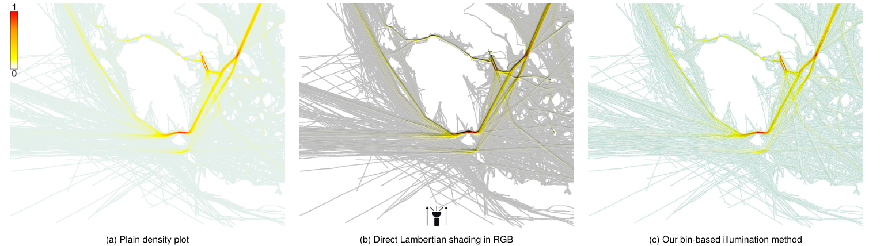
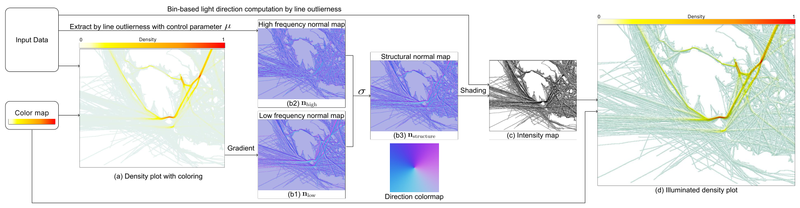
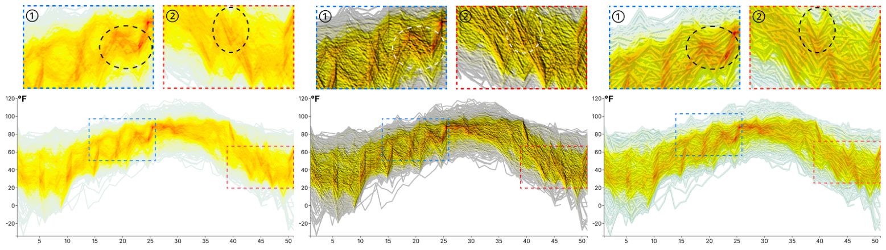

# Enhancing Line Density Plots with Outlier Control and Bin-based Illumination

## (<a href="https://ieeexplore.ieee.org/xpl/RecentIssue.jsp?punumber=2945">IEEE Transactions on Visualization and Computer Graphics</a>, vol. 32, no. 6, 2026)

### <a href="http://www.yumengxue.net/" target="_blank">Yumeng Xue</a>1&nbsp; &nbsp; Bin Chen1&nbsp; &nbsp; Patrick Paetzold1&nbsp; &nbsp; <a href="http://www.yunhaiwang.net/" target="_blank">Yunhai Wang</a>2&nbsp; &nbsp;   <a href="https://recherche.enac.fr/~hurter/" target="_blank">Christophe Hurter</a>3,4&nbsp; &nbsp; <a href="https://www.cgmi.uni-konstanz.de/en/persons/prof-dr-oliver-deussen/" target="_blank">Oliver Deussen</a>1&nbsp; &nbsp;
**1****University of Konstanz** &nbsp;
**2****Renmin University of China** &nbsp;
**3****Fédération ENAC ISAE-SUPAERO ONERA, Université de Toulouse** &nbsp;
**4****IPAL, Singapore** &nbsp;

## Abstract
Density plots effectively summarize large numbers of points, which would otherwise lead to severe overplotting in, for example, a scatter plot. However, when applied to line-based datasets, such as trajectories or time series, density plots alone are insufficient, as they disrupt path continuity, obscuring smooth trends and rare anomalies. We propose a bin-based illumination model that decouples structure from density to enhance flow and reveal sparse outliers while preserving the original colormap. We introduce a bin-based outlierness metric to rank trajectories. Guided by this ranking, we construct a structural normal map and apply locally-adaptive lighting in the luminance channel to highlight chosen patterns—from dominant trends to atypical paths—with acceptable color distortion. Our interactive method enables analysts to prioritize main trends, focus on outliers, or strike a balance between the two. We demonstrate our method on several real-world datasets, showing it reveals details missed by simpler alternatives, achieves significantly lower CIEDE2000 color distortion than standard shading, and supports interactive updates for up to 10,000 lines.

## Materials
**Paper**: <a href="https://doi.org/10.1109/TVCG.2026.3694447" target="_blank">10.1109/TVCG.2026.3694447</a>  
**Preprint**: <a href="https://arxiv.org/abs/2512.16017" target="_blank">arXiv:2512.16017</a>  
**Supplementary Material**: <a href="https://osf.io/py5dz/files/46wct" target="_blank">osf.io/py5dz</a>

## Results
|  |
|:--:|
| 
**Figure 1: Comparison of line-density visualization methods on vessel trajectories. (a) Plain density plot highlights only high-density regions while obscuring continuity and sparse lines; (b) Direct Lambertian shading in RGB introduces color distortion and orientation bias; (c) Our bin-based illumination decouples normals from density, adapts light per bin, and preserves the colormap while enhancing both dense trends and sparse anomalies.**
 |

|  |
|:--:|
| 
**Figure 2: Pipeline for enhanced, discretized line density plots: (a) Initial density plot; (b) Normal maps, including low- and high-frequency normal maps, composed by user defined parameters to construct a structure normal map for rendering; (c) Intensity map with user-controlled low- and high-frequency patterns computed from structure map via bin-based light direction optimization; (d) Illuminated density plot combining density and shading.**
 |

|  |
|:--:|
| 
**Figure 3: Application of our method on the temperature dataset. In the density plot of (a), the flow of the lines is not visible (see circled areas in cut-outs ① and ②), also not in the directly Lambertian shaded version of (b). Our method (c) allows the viewer to follow the ups and downs of the lines, which is especially visible in the encircled regions. A 5×5 kernel generates all of the results.**
 |

## Acknowledgments
This work was funded in part by Deutsche Forschungsgemeinschaft (DFG) Project 410883423 and Project 251654672 – TRR 161 "Quantitative methods for visual computing." Yunhai Wang was supported by the grants of NSFC (No.62132017 and No.U2436209), the Shandong Provincial Natural Science Foundation (No.ZQ2022JQ32), the Fundamental Research Funds for the Central Universities, and the Research Funds of Renmin University of China.
