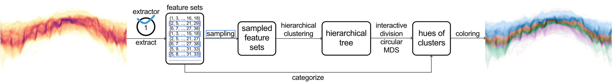
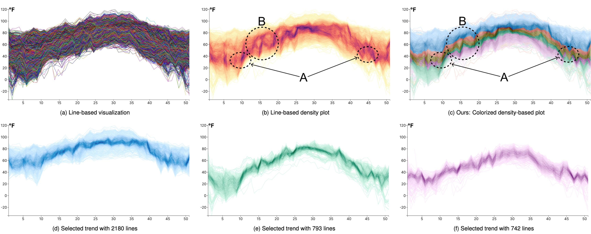
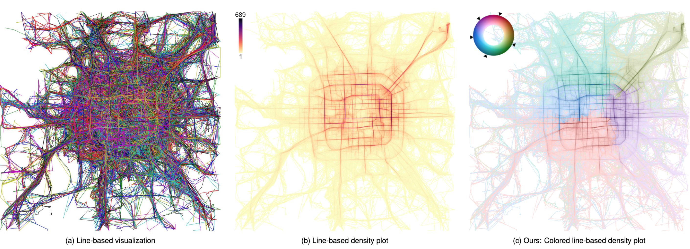

# Reducing Ambiguities in Line-based Density Plots by Image-space Colorization

## (Proceedings of <a href="http://ieeevis.org/year/2023/welcome">IEEE VIS 2023</a>)

### <a href="http://www.yumengxue.net/" target="_blank">Yumeng Xue</a>1,2&nbsp; &nbsp; Patrick Paetzold1&nbsp; &nbsp; Rebecca Kehlbeck1&nbsp; &nbsp; Bin Chen1&nbsp; &nbsp;   <a href="https://webpages.csus.edu/kwan/" target="_blank">Kin Chung Kwan</a>3&nbsp; &nbsp; <a href="http://www.yunhaiwang.net/" target="_blank">Yunhai Wang</a>2&nbsp;&nbsp; <a href="https://www.cgmi.uni-konstanz.de/en/persons/prof-dr-oliver-deussen/" target="_blank">Oliver Deussen</a>1&nbsp; &nbsp;
**1****University of Konstanz** &nbsp;
**2****Shandong University** &nbsp;
**3****California State University Sacramento** &nbsp;

## Abstract
Line-based density plots are used to reduce visual clutter in line charts with a multitude of individual lines. However, these traditional density plots are often perceived ambiguously, which obstructs the user's identification of underlying trends in complex datasets. Thus, we propose a novel image space coloring method for line-based density plots that enhances their interpretability. Our method employs color not only to visually communicate data density but also to highlight similar regions in the plot, allowing users to identify and distinguish trends easily. We achieve this by performing hierarchical clustering based on the lines passing through each region and mapping the identified clusters to the hue circle using circular MDS. Additionally, we propose a heuristic approach to assign each line to the most probable cluster, enabling users to analyze density and individual lines. We motivate our method by conducting a small-scale user study, demonstrating the effectiveness of our method using synthetic and real-world datasets, and providing an interactive online tool for generating colored line-based density plots.

## Materials
**Online Demo**: <a href="https://color-line-density-plot.github.io/">color-line-density-plot.github.io</a>  
**Source Code**: <a href="https://github.com/AiHxym/colored-line-density">github.com/AiHxym/colored-line-density</a></h2>

## Results
|  |
|:--:| 
| 
**Figure 1: Processing pipeline: per region (bin) sets of features (line IDs) are obtained by checking which lines pass through a bin. By sampling, we obtain a subset of the bins that allow us to cluster them efficiently. Hierarchical clustering is then applied to find similar bins. Using circular MDS we map cluster centers to the HCL color space to create the rendition.**
 |

|  |
|:--:| 
| 
**Figure 2: Time series of temperature values (6187 lines) visualized using (a) line-based visualization, (b) line–based density plot, and (c) our line-based density plot colorization scheme. (d) - (f): Individual trends selected using our interactive tool.**
 |

|  |
|:--:| 
| 
**Figure 3: Trajectories of taxi rides in Beijing: (a) A line-based visualization of the trajectories is cluttered and convoluted; (b) Using a density plot eliminates clutter, but the continuation of the trends is ambiguous, e.g., it looks like taxis follow the prominent, circular route around the city center; (c) Pixel-based colorization reveals clusters, we see that taxis mostly stay in one part of the city.**
 |

## Acknowledgments
This work was supported in part by Deutsche Forschungsgemeinschaft (DFG) Project 410883423, Project 251654672 – TRR 161 “Quanti- tative methods for visual computing”, KE 740/17-2 of the FOR2111 “Questions at the Interface”, the National Key R&D Program of China (2022ZD0160805), NSF China (No.62132017, 62141217), and the Shandong Provincial Natural Science Foundation (No. ZQ2022JQ32).