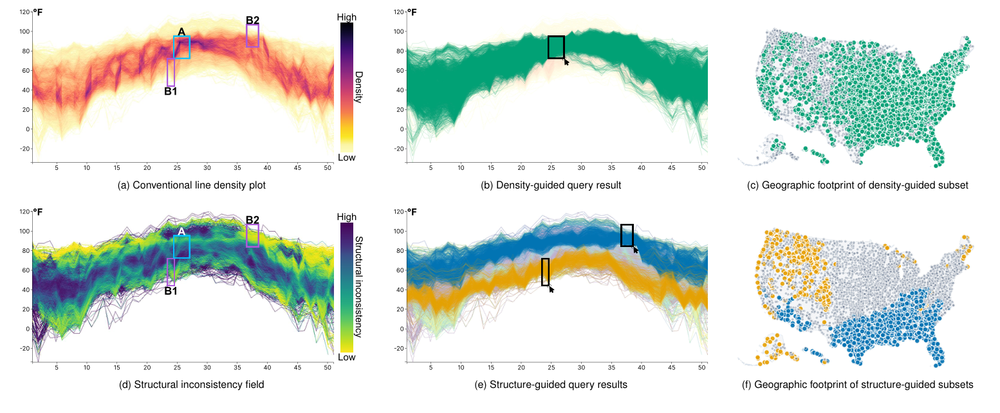
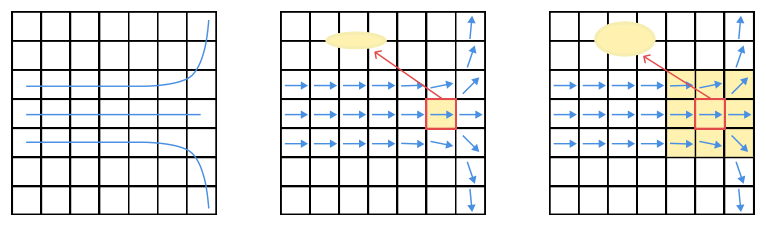
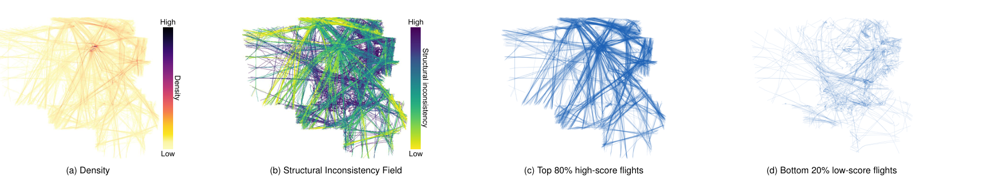

# Structuring Line Ensembles with Path-Integrated Fidelity and Structural Inconsistency Fields

## (<a href="https://ieeexplore.ieee.org/xpl/RecentIssue.jsp?punumber=2945">IEEE Transactions on Visualization and Computer Graphics</a>, to appear 2027)

### <a href="http://www.yumengxue.net/" target="_blank">Yumeng Xue</a>1&nbsp; &nbsp; Patrick Paetzold1&nbsp; &nbsp; Bin Chen1&nbsp; &nbsp; <a href="http://www.yunhaiwang.net/" target="_blank">Yunhai Wang</a>2&nbsp; &nbsp;   <a href="https://recherche.enac.fr/~hurter/" target="_blank">Christophe Hurter</a>3,4&nbsp; &nbsp; <a href="https://www.cgmi.uni-konstanz.de/en/persons/prof-dr-oliver-deussen/" target="_blank">Oliver Deussen</a>1&nbsp; &nbsp;
**1****University of Konstanz** &nbsp;
**2****Renmin University of China** &nbsp;
**3****ENAC, Université de Toulouse** &nbsp;
**4****IPAL, Singapore** &nbsp;

## Abstract
When visualizing large-scale line ensembles, trajectory continuity and visual scalability are inherently antagonistic. Trajectory-centric renderings preserve path information but rapidly degenerate into clutter as line density increases and mutual occlusion dominates. In contrast, field-based density representations enhance visibility while sacrificing structural coherence: density reflects accumulation rather than agreement, such that scalar aggregation alone cannot discriminate between consistent and conflicting configurations. Rather than replacing density-based views, we complement them with a path-integrated trajectory-fidelity measure that quantifies the agreement of each trajectory with a surrounding tensor field. By projecting this passage-centered structural support back into image space, we obtain what we call a Structural Inconsistency Field, which localizes regions where dense patterns correspond to coherent structure versus disagreement, outliers, or connectivity-induced ambiguity. Dynamic leave-one-out correction reduces self-bias in the path integral. Efficient fixed-grid updates combined with prefix-sum evaluation enable interactive analysis and iterative extraction of coherent structures. Synthetic benchmarks, scalability analyses, and real-world case studies demonstrate that, when paired with conventional density views, the proposed method disambiguates dense line patterns by exposing spatially localized coherence and structural breakdown that remain concealed in density-only representations.

## Materials
**Preprint**: <a href="https://arxiv.org/abs/2607.25121" target="_blank">arXiv:2607.25121</a>  
**Source Code**: <a href="https://github.com/AiHxym/structuring-line-ensembles" target="_blank">github.com/AiHxym/structuring-line-ensembles</a>

## Results
|  |
|:--:|
| 
**Figure 1: Weekly maximum temperature series from 6,187 U.S. weather stations. The density view (a) emphasizes hotspot A, whose query result remains broad and geographically diffuse (b,c). The structural inconsistency field (d) instead makes corridors B1 and B2 salient, yielding more coherent query results and a clearer north–south geographic separation (e,f).**
 |

|  |
|:--:|
| 
**Figure 2: Construction of the structure tensor field. (a) Trajectories are rasterized onto the analysis grid. (b) With a minimal kernel (1×1), the tensor records only the instantaneous tangent. (c) A wider spatial kernel (3×3) aggregates neighborhood statistics and reveals crossings or divergences through increased isotropy.**
 |

|  |
|:--:|
| 
**Figure 3: France aviation case study. The full dataset contains 5,360 trajectories. The density map emphasizes the dominant traffic corridors but leaves minority behaviors visually entangled with them. The structural inconsistency field localizes where structural support weakens. Ranking trajectories by Φ(L) then separates the dataset into a top 80% high-score subset (4,288 trajectories), which captures the main long-range, route-regular commercial traffic pattern, and a bottom 20% low-score subset (1,072 trajectories), which analysts informally interpreted as including many smaller-aircraft trajectories, such as private light aircraft, together with looping or holding-like paths and trajectories affected by recording errors.**
 |

## Acknowledgments
This work was funded in part by Deutsche Forschungsgemeinschaft (DFG) Project 410883423 and Project 251654672 – TRR 161 "Quantitative methods for visual computing." Yunhai Wang was supported by the grants of NSFC (No.62132017 and No.U2436209), the Shandong Provincial Natural Science Foundation (No.ZQ2022JQ32), the Fundamental Research Funds for the Central Universities, and the Research Funds of Renmin University of China.
